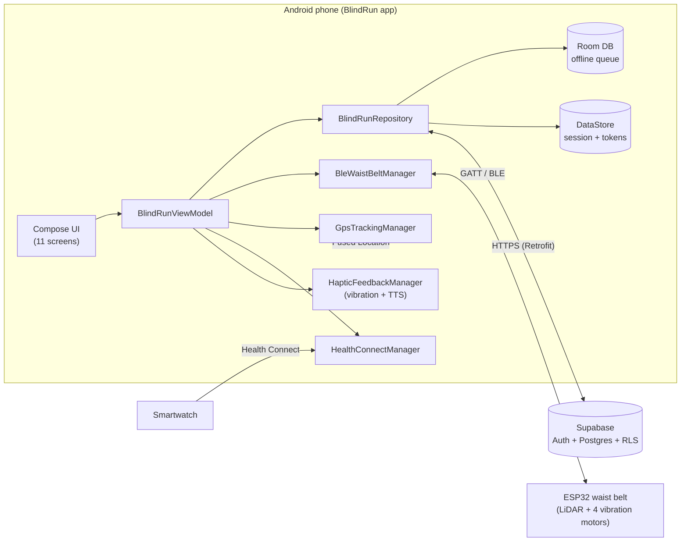
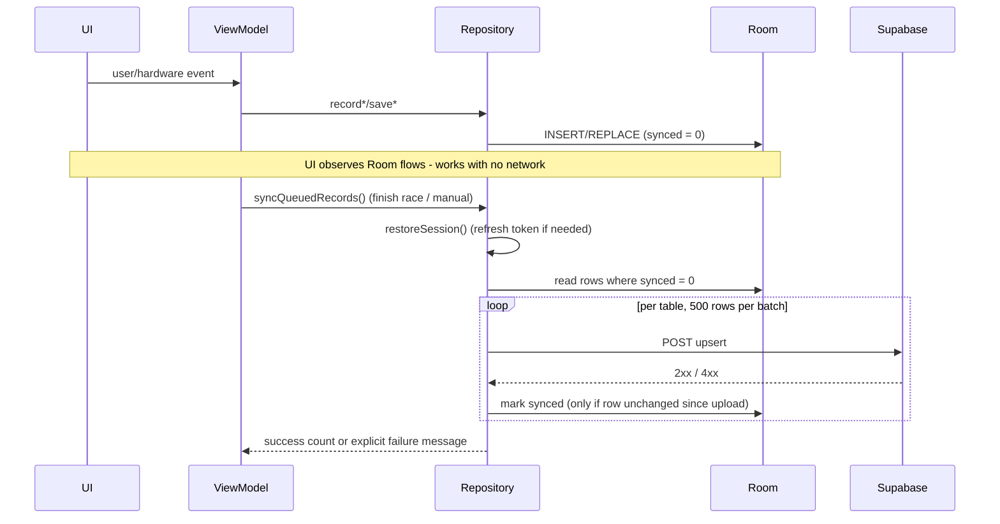

# BlindRun Kenya — Architecture Overview

Assistive running platform for visually impaired and deafblind athletes: a phone app pairs with an
ESP32 smart waist belt over Bluetooth LE, turns obstacle detections and route guidance into
directional haptic/audio cues, tracks the run with GPS, reads smartwatch health data, and shares
consented summaries with coaches and administrators.

* **Client:** native Android (Kotlin, Jetpack Compose, single Activity), `minSdk 26`, `targetSdk 36`
* **Backend:** Supabase (GoTrue auth + PostgREST over PostgreSQL with Row-Level Security)
* **Offline-first:** everything is written to a local Room database first, then synced

---

## 1. System context



## 2. Technology stack

| Concern | Choice |
|---|---|
| Language / UI | Kotlin 2.4, Jetpack Compose (Material 3), Navigation-Compose (type-safe `@Serializable` routes) |
| Local storage | Room 2.7 (KSP), Preferences DataStore |
| Networking | Retrofit 2.12 + OkHttp + Moshi (codegen) against Supabase REST/Auth |
| Concurrency | Kotlin coroutines + `StateFlow` / `SharedFlow` |
| Hardware | Android BLE (GATT), Fused Location Provider, Health Connect 1.1, Vibrator/VibrationEffect, TextToSpeech |
| QR | CameraX + ZXing core |
| Config | Secrets Gradle plugin: `SUPABASE_URL`, `SUPABASE_ANON_KEY` from `.env` → `BuildConfig` |

## 3. Code map

```
app/src/main/java/com/example/
├─ MainActivity.kt                 Nav host, role-aware bottom bar / rail, auth gate
├─ ui/
│  ├─ navigation/Routes.kt         AppRoute (Auth, Onboarding, Dashboard, Devices, QrScanner,
│  │                               RaceHub, LiveRace(raceId), Health, History, Profile,
│  │                               CoachDashboard, AdminDashboard)
│  ├─ screens/                     One file per screen (stateless composables)
│  ├─ components/CommonComponents.kt
│  ├─ theme/                       Color / Type / Theme
│  └─ viewmodel/BlindRunViewModel  The orchestrator (see §5)
├─ data/
│  ├─ model/DomainModels.kt        Pure Kotlin domain types + enums (UserRole, RaceStatus, ...)
│  ├─ local/                       Room: Entities (+ mappers), Daos, BlindRunDatabase,
│  │                               SessionPreferences (DataStore)
│  ├─ remote/                      SupabaseApiService (Retrofit), SupabaseDtos, SupabaseClient, SupabaseConfig
│  └─ repository/BlindRunRepository  Single source of truth: Room ⇄ Supabase, auth, sync
└─ hardware/
   ├─ BleWaistBeltManager          Scan, connect, GATT queue, obstacle stream, QR parsing
   ├─ GpsTrackingManager           Location updates, drift filter, route maths, GPX/TCX parser
   ├─ HealthConnectManager         Permission check + 24 h snapshot of watch data
   └─ HapticFeedbackManager        Per-direction vibration waveforms + spoken cues
supabase/schema.sql                Tables, RLS policies, helper functions
supabase/migrations/               Incremental SQL for existing projects
```

### Layering rules
1. **UI** only renders `StateFlow`s from the ViewModel and calls its functions.
2. **ViewModel** coordinates hardware managers and the repository; it never talks to Retrofit or Room directly.
3. **Repository** is the only class that knows both Room and Supabase. UI reads *only* from Room.
4. **Hardware managers** expose `StateFlow`/`SharedFlow` and have no knowledge of the UI or database.

## 4. Data model

Postgres tables (all with RLS) and their Room mirrors:

| Table | Purpose | Notes |
|---|---|---|
| `profiles` | One row per `auth.users` account | `role` ∈ athlete / coach / admin, accessibility mode, haptic intensity, emergency contact, `consented_coach_sharing` |
| `coach_athlete_assignments` | Which coach may see which athlete | Written by admins only |
| `devices` | ESP32 belt registry | `serial_code` unique, `owner_athlete_id` nullable (unclaimed belts) |
| `races` | Race config + live/final stats | Text id (client generated), route waypoints as JSON |
| `gps_trackpoints` | Per-fix track | Append-only |
| `obstacle_events` | Belt detections | Append-only; direction front/back/left/right |
| `health_records` | Health Connect snapshots | Append-only; deterministic id for de-duplication |
| `alerts` | Disconnects, route deviation, race completed | `acknowledged` mutable |
| `admin_audit_logs` | Admin actions | Admin only |

Room entities carry an extra `synced: Boolean` column — that flag **is** the upload queue.
Ids are generated on the phone (UUID strings) so records can be created offline and upserted later.

## 5. Runtime design

### 5.1 Session & authentication
* `signInWithSupabase` → GoTrue password grant → fetch `profiles` row → cache in Room → save tokens/role in DataStore.
* **Offline mode:** a local-only profile (`local-<uuid>` id) with no tokens; races and telemetry are queued but cannot sync.
* `restoreSession()` refreshes the access token when it is within 60 s of expiry; it is called at app start **and** before every network operation.
* The role stored on the device is only used to shape the UI. **Authorisation is enforced by Postgres RLS.**

### 5.2 Offline-first sync

* Append-only tables use `Prefer: resolution=ignore-duplicates` (retries are idempotent and need only INSERT permission).
* Mutable tables (profiles, devices, races, alerts) use `merge-duplicates` and are marked synced only if the row did not change while the request was in flight.
* Sign-out flushes the queue, then wipes the local DB if nothing is left unsynced.

### 5.3 Race lifecycle
`configured → running ⇄ paused → completed`

* While running, two producers update the race: a **1 Hz wall-clock timer** (elapsed time, pace) and the **GPS callback** (distance, deviation, calories). Both go through `mutateActiveRace`, which reads the current row inside a mutex, applies the change and writes it back, so neither can overwrite the other.
* On app start any race still marked `running` (process was killed) is set to `paused`.
* Finishing a race records a completion alert and triggers a sync.

### 5.4 GPS & route guidance
* Fused location, `PRIORITY_HIGH_ACCURACY`, 2 s interval, 2 m minimum displacement.
* Fixes worse than 28 m accuracy are shown but not counted; implied speed > 12.5 m/s is rejected as drift; movement < 1.5 m is treated as jitter.
* **Route deviation** = shortest distance to the route *polyline* (point-to-segment). Threshold 35 m, with hysteresis (clears below 24.5 m). One stored alert per excursion; the audio/haptic cue repeats every 15 s while off route.
* Routes come from GPX/TCX import (`trkpt`/`rtept`/`wpt`, TCX `Position`) or are empty (no guidance).

### 5.5 Waist belt (BLE) protocol

| Item | UUID / format |
|---|---|
| Custom service | `6e400001-b5a3-f393-e0a9-e50e24dcca9e` |
| Race config (write) | `…0002…` — ASCII `CFG|<name≤24>|<totalMeters>|<status>` |
| Obstacle stream (notify) | `…0003…` — ASCII `OBS:FRONT:85:HIGH` or `FRONT,85,HIGH` (direction, cm, severity) |
| Haptic command (write) | `…0004…` — ASCII `HAP|<motor 1-4>|<intensity 20-100>` |
| Diagnostics (read) | `…0005…` — free text |
| Battery | standard `0x180F` / `0x2A19` |

Motor channels: 1 = front, 2 = back, 3 = left, 4 = right.

Connection handling:
* `connectGatt(autoConnect = true)` so Android reconnects after short drops; a disconnect raises a haptic/spoken warning and a stored alert.
* After service discovery the app **verifies the BlindRun service exists** (otherwise disconnects), then runs a **serial GATT operation queue** (obstacle CCCD → battery read/notify → diagnostics) with a 3 s watchdog, because Android allows only one outstanding GATT operation.
* Unknown/malformed obstacle frames are dropped (never guessed as "front").

QR pairing: `blindrun://belt?serial=…&mac=…&name=…&fw=…` or `SERIAL|MAC|NAME`. QR payloads that contain `secret=`, `password=` or `token=` are rejected — QR codes identify a belt, they never carry credentials.

### 5.6 Obstacle → feedback pipeline
`BLE notify → parse → ViewModel.collect → HapticFeedbackManager (vibration waveform per direction, TTS unless Deafblind mode) → Room (obstacle_events)`.
Cues are throttled to one per direction per 700 ms and history rows to one per direction per 1.5 s, except HIGH-severity obstacles which are never throttled.

### 5.7 Health data
Health Connect read-only: heart rate, steps, active calories, exercise, distance, SpO₂, sleep. `readLatestSmartwatchSnapshot` aggregates the last 24 h into one `HealthMetricRecord` with a per-minute deterministic id (so repeated syncs de-duplicate).

## 6. Security model

| Role | Can see | Can change |
|---|---|---|
| Athlete | Own profile, devices, races, GPS, obstacles, health, alerts; unowned belts | Own data; claim an unowned belt |
| Coach | Everything above for **assigned** athletes. Health records only if the athlete set `consented_coach_sharing` | Races and alerts of assigned athletes |
| Admin | Everything | Roles, assignments, devices, audit log |

* Role changes and admin creation are guarded by a database trigger (`profiles_guard_role`); the first admin is created from the Supabase SQL editor.
* Helper functions `is_admin()` / `is_assigned_coach()` are `SECURITY DEFINER` with a pinned `search_path`.
* Tokens live in DataStore (app-private). Cloud backup and device-transfer are disabled so tokens and health data never leave the device through Android backup.
* HTTP logging is compiled in only for debug builds and redacts auth headers.

## 7. Build, run, configure
1. Open in Android Studio; create `.env` from `.env.example` (`SUPABASE_URL`, `SUPABASE_ANON_KEY`).
2. In Supabase → SQL editor run `supabase/schema.sql` (new project) **or** `supabase/migrations/20261127_security_and_sync_fixes.sql` (existing project).
3. Promote your first admin: `update public.profiles set role = 'admin' where email = 'you@example.com';`
4. Run on a device (BLE, GPS and Health Connect need real hardware; the app also works in *Offline Mode* without Supabase).
5. Release builds need `KEYSTORE_PATH`, `STORE_PASSWORD`, `KEY_PASSWORD` in the environment.

## 8. Known limitations / roadmap
See `docs/CODE_REVIEW.md` → *Open items*. The most important: tracking runs inside the Activity's ViewModel, so a **foreground service** is needed before real-world use with the screen off.
